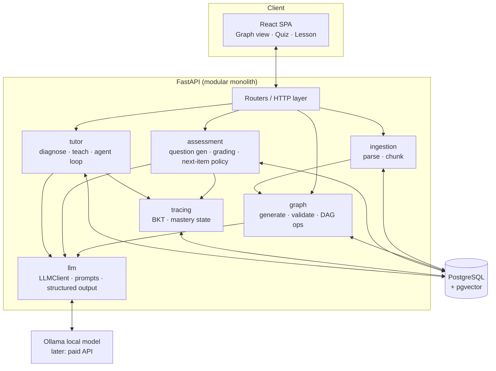
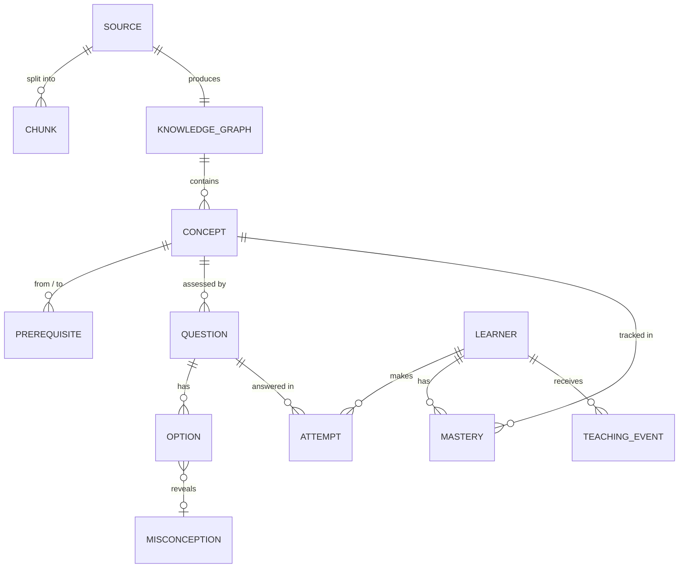

# AAKTT+ — Adaptive Agentic Knowledge-Tracing Tutor

> **Status:** v1.0, approved 2026-10-19 (decisions recorded in §7)
> **Date:** 2026-10-19
> **Scope of this document:** System vision, tech stack, the 4-phase roadmap, and the ML/CS concepts to learn in each phase. No application code yet.

---

## 1. What we're building

A tutor that works in four steps:

1. **Understands** a document or topic by breaking it into a **Directed Acyclic Graph (DAG)** of concepts. An edge `A → B` means "A is a prerequisite of B".
2. **Assesses** what the learner already knows by asking targeted questions and moving through the graph intelligently, without simply quizzing every node.
3. **Tracks** each learner's knowledge as a **probability per concept**. This is *knowledge tracing*, and it updates after every answer.
4. **Teaches adaptively.** When the learner gets something wrong, it works out *why* (a missing prerequisite? a specific misconception? a careless slip?) and teaches to that exact gap. Then it re-checks.

```mermaid
flowchart LR
    A[Document / Topic] --> B[Concept DAG]
    B --> C[Adaptive Assessment]
    C --> D[Knowledge State<br/>P(mastery) per concept]
    D --> E[Diagnose Failure]
    E --> F[Targeted Teaching]
    F --> C
```

The core idea is that **the LLM is a component, not the brain.** The LLM generates content: graphs, questions, explanations. **Deterministic, inspectable code** makes the decisions: graph validation, probability updates, choosing what to ask next. That split keeps the system testable, debuggable and cheap. It also means you learn the real math rather than hiding it inside a prompt.

---

## 2. Tech stack (and why)

### 2.1 The decision: Python + FastAPI

| Option | LLM SDKs | Numerics / ML (NumPy, PyTorch, scikit-learn) | Async I/O for LLM calls | Verdict |
|---|---|---|---|---|
| **Python / FastAPI** | First-class | **Best in class** | Good (`asyncio`) | ✅ **Chosen** |
| Node / Express | First-class | Weak; you'd shell out to Python for Phase 4 | Excellent | ❌ Two-language system by Phase 4 |
| Java / Spring | Decent | Weak | Good, but verbose | ❌ Lots of ceremony, small AI ecosystem |

**Why it matters:** Phases 2–4 involve probability, parameter fitting and possibly a small neural network. In Python those are one import away, and the same language serves the web API. With **Pydantic**, one class definition is the API schema, the database DTO *and* the JSON schema we force the LLM to follow. That reuse makes up for a lot.

### 2.2 Full stack

| Layer | Choice | Introduced | Notes |
|---|---|---|---|
| Language | **Python 3.13** | Phase 1 | Type hints everywhere |
| Package / env manager | **uv** | Phase 1 | Fast and reproducible (`uv.lock`) |
| Web framework | **FastAPI** + Uvicorn | Phase 1 | Async, auto-generated OpenAPI/Swagger UI |
| Validation / schemas | **Pydantic v2** | Phase 1 | Also validates LLM output |
| LLM runtime | **Ollama** (local, free) | Phase 1 | Runs open-weights models on your GPU. A paid API can be added later behind the same interface (ADR-6) |
| LLM access | **Ollama's HTTP API, called directly with `httpx`** | Phase 1 | Wrapped in our own thin `LLMClient` interface. **No LangChain or LlamaIndex** (see §2.3) |
| Database | **PostgreSQL 16** | Phase 1 | Relational data fits graphs + event logs well |
| ORM / migrations | **SQLAlchemy 2.0** + **Alembic** | Phase 1 | Explicit SQL-ish style, versioned schema |
| Graph algorithms | **Our own code** (adjacency list, Kahn's algorithm) | Phase 1 | NetworkX is used *only in tests* as a reference to check our implementation |
| Document parsing | **PyMuPDF** (PDF), plain text/Markdown | Phase 1 | |
| Numerics | **NumPy** | Phase 2 | BKT, entropy, simulations |
| Vector search | **pgvector** (Postgres extension) | Phase 3 | No separate vector DB; one database to run |
| Embeddings | Local embedding model via Ollama (e.g. `nomic-embed-text`) | Phase 3 | Free, runs on the same machine |
| ML / evaluation | **scikit-learn** (metrics), **PyTorch** (Deep Knowledge Tracing) | Phase 4 | |
| Frontend | **React + TypeScript + Vite**, **React Flow** (graph view), **TanStack Query** | End of Phase 1 | Swagger UI is our "frontend" until then |
| Testing | **pytest**, recorded LLM fixtures, an eval set | Phase 1 | Unit tests never hit a live LLM |
| Quality | **ruff** (lint + format), **mypy** (types) | Phase 1 | |
| Infra | **Docker Compose** (Postgres + API), **GitHub Actions** CI | Phase 1 | |

**Default LLM models**, all behind config so they're easy to change. They are sized for the dev machine: an RTX 4060 Laptop GPU (8 GB VRAM) with 32 GB RAM.
- Main model (graph generation, questions, teaching, diagnosis): an **~8B instruct model at 4-bit quantization** (e.g. `qwen3:8b`). About 5 GB, so it fits fully on the GPU.
- Fallback for hard tasks: a ~14B model partly offloaded to system RAM. Slower, but noticeably smarter.
- Which model actually wins is **measured with our evals, not guessed**. Picking the model is a Phase 1 experiment.
- Paid APIs (Claude, etc.) are a *later* option behind `LLMClient`, e.g. if this becomes a product.

### 2.3 Key architectural decisions

| # | Decision | Why |
|---|---|---|
| ADR-1 | **No agent frameworks (LangChain etc.)** | They hide the loop you need to understand. An "agent" is a `while` loop + an LLM call + a tool dispatch table. We write that ourselves in about 100 lines. This follows the *No Magic* rule in `CLAUDE.md`. |
| ADR-2 | **The LLM proposes, code decides** | The LLM outputs JSON that is validated by Pydantic and *then* checked by deterministic code (e.g. cycle detection). A bad LLM output gets rejected or repaired; it never silently corrupts state. |
| ADR-3 | **Append-only interaction log** | Every answer is stored as an immutable `attempt` event. The mastery state is a *derived* view that can always be recomputed. Phase 4 depends on this: you can't fit models on data you overwrote. |
| ADR-4 | **Modular monolith, not microservices** | One deployable FastAPI app with clean internal modules. Microservices add network failures and deployment pain with no benefit at our scale. |
| ADR-5 | **Prompts are versioned files, not inline strings** | `prompts/graph_generation.v1.md`. A prompt is code: diff it, review it, test it. Each LLM call logs the prompt version it used. |
| ADR-6 | **Local-first LLMs behind a provider interface** | Testing is free with a local model. Small models are weaker, which pushes us toward good engineering anyway: constrained JSON output, smaller focused prompts, validation. Moving to a paid API later is a config change plus one new `LLMClient` class, not a rewrite. |

---

## 3. System architecture



**Dependency rule:** `tracing` (the math) depends on *nothing* else, so it is pure functions you can unit-test with pencil-and-paper numbers. `llm` depends on nothing in our domain. Domain modules depend on those two, never the reverse.

### 3.1 Planned repository layout

```
AAKTT+/
├── ARCHITECTURE.md
├── CLAUDE.md
├── docker-compose.yml
├── backend/
│   ├── pyproject.toml
│   ├── app/
│   │   ├── main.py
│   │   ├── config.py
│   │   ├── api/            # FastAPI routers (thin)
│   │   ├── llm/            # LLMClient, structured-output helper
│   │   │   └── prompts/    # versioned prompt files
│   │   ├── ingestion/      # PDF/text parsing, chunking
│   │   ├── graph/          # DAG data structure, validation, generation
│   │   ├── assessment/     # questions, grading, selection policy
│   │   ├── tracing/        # BKT and friends (pure math, no I/O)
│   │   ├── tutor/          # diagnosis + teaching agent
│   │   └── db/             # SQLAlchemy models, Alembic migrations
│   └── tests/
├── frontend/               # React app (from end of Phase 1)
├── evals/                  # golden datasets + scripts to score LLM output quality
└── docs/adr/               # one file per architectural decision
```

### 3.2 Core data model (evolves per phase)



| Table | Phase | Purpose |
|---|---|---|
| `source`, `chunk` | 1 (chunk embeddings in 3) | The raw input and its pieces |
| `knowledge_graph`, `concept`, `prerequisite` | 1 | The DAG: nodes + directed edges |
| `question`, `option`, `misconception` | 2 | Assessment items; wrong options map to *named* misconceptions |
| `learner`, `attempt` | 2 | Append-only event log (ADR-3) |
| `mastery` | 2 | Current `P(known)` per (learner, concept), derived from attempts |
| `teaching_event` | 3 | What was taught, why, and whether it worked |

---

## 4. The four phases

Each phase ends with a **working, demo-able system**, not a half-built layer. Phases are split into small milestones; we stop for review after each one (per `CLAUDE.md`).

---

### Phase 1 — Knowledge Graph Generation
**Goal:** Give the system a topic or a document and get back a *valid, sensible* concept DAG that is saved and viewable.

**Milestones**
1. **Project skeleton:** uv, FastAPI hello-world, Docker Compose Postgres, pytest, ruff, CI.
2. **The DAG data structure, by hand:** adjacency list, `add_edge`, cycle detection, topological sort (Kahn's algorithm), finding roots and leaves, ancestors/descendants. Pure Python, fully unit-tested, checked against NetworkX in tests.
3. **LLM client + structured output:** a thin `LLMClient` over Ollama, a Pydantic schema `ConceptGraph {concepts[], edges[]}`, **schema-constrained decoding** (Ollama's `format` parameter takes a JSON Schema), and a retry-with-error-feedback loop when validation fails. Includes a small model comparison: run 2–3 local models on the same 5 topics and score the graphs.
4. **Graph generation from a topic:** prompt → JSON → Pydantic → DAG validation → **repair** (if the LLM produced a cycle, remove the weakest edge or re-prompt with the cycle named) → **transitive reduction** (drop `A→C` when `A→B→C` exists).
5. **Graph generation from a document:** PDF/text parsing → chunking → per-chunk concept extraction (map) → merge + deduplicate concepts (reduce) → edges.
6. **Persistence + API:** save graphs; `POST /graphs`, `GET /graphs/{id}`.
7. **Minimal frontend:** React Flow view of the graph (topologically layered).

**Definition of done:** "Linear Algebra" or a 20-page PDF becomes an acyclic graph of about 10–40 concepts that a human judges reasonable, visible in the browser, with all DAG code covered by tests.

**You will write yourself:** cycle detection and Kahn's topological sort.

**Concepts to learn**

| Area | Concept | Why it's needed here |
|---|---|---|
| CS / Graphs | DAGs, adjacency lists, DFS, **cycle detection** (3-color DFS) | The core data structure of the whole product |
| CS / Graphs | **Topological sort (Kahn's algorithm)** | Teaching order: never teach B before its prerequisite A |
| CS / Graphs | **Transitive reduction** | LLMs add redundant edges; a cleaner graph means better diagnosis later |
| LLM fundamentals | Tokens, context windows, temperature, sampling | Why a 200-page PDF can't go in one prompt; why output varies between runs |
| LLM fundamentals | **Prompt engineering**: role, few-shot examples, explicit output format | Graph quality is mostly prompt quality |
| LLM fundamentals | **Structured output / JSON Schema / constrained decoding** | Turning free-form text into data our code can trust |
| LLM fundamentals | **Quantization** (what "4-bit" means), VRAM vs. model size, local inference | Choosing a model that fits your GPU |
| LLM fundamentals | Hallucination, non-determinism, validate-and-retry | Why ADR-2 exists |
| NLP | **Chunking strategies**, **map-reduce** over long documents | Handling documents bigger than the context window |
| NLP | Entity deduplication ("Eigenvalue" vs "eigenvalues") | Merging concepts extracted from different chunks |
| Engineering | Async I/O in Python, REST design, DB migrations | Backend basics |

---

### Phase 2 — Adaptive Assessment & Knowledge Tracing
**Goal:** The system *measures* what a learner knows. It asks questions, updates a probability of mastery per concept after each answer, and picks the **most informative** next question instead of quizzing every node.

**Milestones**
1. **Question generation:** for each concept, generate multiple-choice questions where **each wrong option is tied to a specific named misconception** (e.g. "confuses eigenvalue with eigenvector"). This is what makes Phase 3's precise diagnosis possible.
2. **Bayesian Knowledge Tracing (BKT), from scratch, in NumPy:** pure functions, tested against hand-computed examples.
3. **Learner + attempt log:** append-only `attempt` events; `mastery` recomputed from them.
4. **Using the graph during assessment:** passing an advanced concept raises the belief in its prerequisites; failing one raises suspicion about specific prerequisites.
5. **Next-question policy:** choose the concept with the highest **uncertainty (entropy)**, weighted by how many other concepts it informs. This is like a binary search over the graph: start mid-depth and branch up or down.
6. **Stopping rule:** stop when every concept is confidently known or unknown (e.g. `P < 0.2` or `P > 0.85`) or a question budget runs out.
7. **Free-response grading (stretch):** LLM-as-judge with a rubric, returning a structured verdict + confidence.
8. **Frontend:** a quiz UI and a graph colored by mastery (a heatmap over the DAG).

**Definition of done:** A learner takes a ~10–15 question adaptive diagnostic and ends with a mastery map that matches what they actually know. A **simulated learner** with known ground-truth knowledge is correctly identified by the system in tests.

**You will write yourself:** the BKT update function and the entropy-based question selector.

**The core math (preview)**

BKT models each concept as a hidden two-state variable, *known* or *not known*, with four parameters:
`P(L₀)` prior knowledge · `P(T)` chance of learning per step · `P(G)` guess · `P(S)` slip

After a **correct** answer:
`P(L | correct) = P(L)(1 − S) / [ P(L)(1 − S) + (1 − P(L)) G ]`

After an **incorrect** answer:
`P(L | wrong) = P(L) S / [ P(L) S + (1 − P(L))(1 − G) ]`

Then account for learning:
`P(L_next) = P(L | obs) + (1 − P(L | obs)) · T`

It's just Bayes' rule, applied over and over. You'll derive it yourself before we code it.

**Concepts to learn**

| Area | Concept | Why it's needed here |
|---|---|---|
| Probability | **Bayes' theorem**, conditional probability, priors/posteriors | The engine of BKT |
| Probability | Bernoulli variables, independence assumptions (and when they break) | Modeling right/wrong answers |
| ML models | **Bayesian Knowledge Tracing** as a 2-state **Hidden Markov Model** | The knowledge-tracing core |
| ML models | Intro to **Item Response Theory (IRT)**: question difficulty and discrimination | Why some questions tell you more than others |
| Information theory | **Entropy**, **expected information gain** | Picking the most informative next question |
| Learning science | **Knowledge Space Theory** (the theory behind ALEKS) | Formal basis for inferring mastery of one concept from others via prerequisites |
| Assessment design | Distractors, misconception-mapped wrong answers | Wrong answers that *tell you something* |
| LLM | **LLM-as-judge**, rubrics, grader bias and consistency | Grading free-text answers |
| Testing | **Simulation**: synthetic learners with known ground truth | The only way to test an adaptive system before you have users |

---

### Phase 3 — Adaptive Teaching & Failure Diagnosis
**Goal:** When the learner fails, the system figures out *why* and teaches to that gap, grounded in the source material, then verifies the gap closed.

**Milestones**
1. **Diagnosis engine:** combine three signals to rank root causes:
   - *Which misconception* the chosen distractor maps to (from Phase 2)
   - *Which prerequisites* have low mastery (walk *up* the DAG)
   - *An LLM explanation* of a free-text answer, when available

   The output is a structured `Diagnosis { root_cause_concept, misconception?, confidence }`.
2. **Teaching strategies as a fixed menu:** e.g. `re-explain_simpler`, `worked_example`, `analogy`, `counterexample_for_misconception`, `teach_prerequisite_first`. The LLM writes the content; **code picks the strategy** (ADR-2).
3. **Grounding with RAG:** embed document chunks into pgvector, retrieve the relevant passages, and require explanations to cite them. This reduces hallucination and keeps teaching faithful to *the user's* document.
4. **The tutor agent loop, written by hand:** `diagnose → plan → teach → check → update mastery → repeat`, as an explicit **state machine** with tool calls (`get_mastery`, `get_prerequisites`, `retrieve_chunks`, `generate_check_question`). Includes step limits and cost caps.
5. **Learning path:** topological order filtered to "ready to learn" concepts (all prerequisites mastered, the concept itself not yet). This is the *frontier* of the learner's knowledge.
6. **Spaced review (light):** schedule re-checks based on a forgetting curve.
7. **Frontend:** a lesson view, "why am I seeing this" explanations, and the learning path.

**Definition of done:** A learner who fails a question gets a diagnosis that names a specific gap. They get a lesson grounded in their document, then a check question, and their mastery map updates. Diagnosis accuracy is measured on a hand-labeled eval set of wrong answers.

**You will write yourself:** the "ready to learn" frontier computation and the agent loop's state transitions.

**Concepts to learn**

| Area | Concept | Why it's needed here |
|---|---|---|
| NLP / ML | **Embeddings**, vector spaces, **cosine similarity** | Finding relevant passages by meaning |
| NLP / ML | **Retrieval-Augmented Generation (RAG)**, top-k retrieval, re-ranking, chunk size trade-offs | Grounding teaching in the source |
| NLP / ML | Approximate nearest neighbor indexes (HNSW, at a conceptual level) | What pgvector does under the hood |
| Agents | **Agent loop / ReAct pattern**, tool calling, state machines | The tutor's control flow, built without a framework |
| Agents | Guardrails: step limits, cost budgets, loop detection | Agents that don't run away |
| Agents | Reflection / self-critique | Checking an explanation before showing it |
| Learning science | **Zone of Proximal Development**, scaffolding, mastery learning | What "teach at the right level" means formally |
| Learning science | **Ebbinghaus forgetting curve**, spaced repetition (SM-2 → FSRS concepts) | When to re-check old concepts |
| Evaluation | Building **eval datasets**, precision/recall for diagnosis, faithfulness for RAG | Knowing if the tutor is actually right |

---

### Phase 4 — Learning from Data, Optimization & Production
**Goal:** Stop *hand-picking* parameters and strategies. The system **learns** them from logged data, gets measured rigorously, and ships.

**Milestones**
1. **Fitting BKT parameters from data:** estimate `P(L₀), P(T), P(G), P(S)` per concept from the attempt log using **Expectation-Maximization**, with grid search / gradient descent as an easier first step. Validate with **parameter recovery**: simulate learners with known parameters, fit, and check that you get them back.
2. **Evaluation harness:** predict "will the next answer be correct?" and measure **AUC** and **log loss** on a held-out set, split *by learner* to avoid leakage.
3. **Deep Knowledge Tracing (DKT):** a small LSTM in PyTorch trained on the same data. Compare it honestly with BKT. (Often BKT holds up well, and finding that out is a lesson in itself.)
4. **Teaching-strategy selection as a multi-armed bandit:** learn which teaching strategy works best per concept or learner, using ε-greedy, then **Thompson sampling**. The reward is "passed the follow-up check".
5. **LLM quality and cost:** prompt regression evals in CI, caching repeated generations, routing cheap tasks to smaller models, tracking tokens and latency.
6. **Production hardening:** authentication, multi-user isolation, rate limiting, observability (structured logs, traces of each LLM call), deployment (container on a cloud host + managed Postgres).

**Definition of done:** Parameters come from data rather than guesses, with reported AUC. A bandit picks teaching strategies. The app is deployed with auth, and CI runs both unit tests and LLM evals.

**You will write yourself:** the E-step/M-step of EM for BKT, and Thompson sampling with Beta distributions.

> **Data reality check:** real learner data will be scarce. The **synthetic learner simulator** from Phase 2 becomes the training and benchmark data generator here, and that's standard practice in knowledge-tracing research.

**Concepts to learn**

| Area | Concept | Why it's needed here |
|---|---|---|
| Statistics | **Maximum Likelihood Estimation (MLE)** | What "fitting parameters" actually means |
| Statistics | **Expectation-Maximization (EM)**, forward-backward algorithm for HMMs | Fitting BKT when "knowing" is hidden |
| ML fundamentals | Train/validation/test splits, **data leakage**, cross-validation | Honest evaluation |
| ML fundamentals | **AUC-ROC**, **log loss**, calibration | Scoring a probability predictor |
| ML fundamentals | Overfitting, regularization, identifiability (BKT's guess/slip degeneracy) | Why fitted parameters can be nonsense |
| Deep learning | Neural network basics, backpropagation, **RNNs/LSTMs**, sequence modeling | Deep Knowledge Tracing |
| Decision making | **Multi-armed bandits**: explore vs. exploit, ε-greedy, UCB, **Thompson sampling**, Beta-Bernoulli conjugacy | Learning the best teaching strategy online |
| Experimentation | A/B testing, statistical significance | Proving a change actually helps learners |
| MLOps / LLMOps | Eval-driven development, prompt regression testing, caching, cost/latency monitoring | Running AI features responsibly |

---

## 5. Cross-cutting concerns

| Concern | Approach |
|---|---|
| **Testing LLM code** | Unit tests use recorded/fake LLM responses (deterministic, free). A separate `evals/` suite hits the real model on golden examples and scores outputs; it runs on demand and in CI nightly, not on every commit. |
| **Cost / latency control** | Every LLM call logs model, prompt version, input/output tokens and latency. Local models cost nothing, but they are *slow*, so latency is the budget we watch. Per-request step caps. Cache generated graphs and questions keyed by input hash. |
| **Secrets** | API keys only in `.env` (git-ignored) loaded via Pydantic Settings. Never committed. |
| **Reproducibility** | Seeded randomness in simulations, pinned dependencies (`uv.lock`), versioned prompts. |
| **Observability** | Structured JSON logs from day one, with a request ID that follows each request through every LLM call. |

---

## 6. Risks & mitigations

| Risk | Impact | Mitigation |
|---|---|---|
| Small local models are weaker at reasoning and long JSON | Lower-quality graphs and questions | Constrained decoding, per-chunk prompts instead of one giant prompt, measure with evals, use the 14B fallback for the hardest step, paid API remains an option (ADR-6) |
| LLM generates bad or cyclic graphs | Wrong prerequisites lead to wrong diagnosis | ADR-2 validation + repair, transitive reduction, a human-editable graph in the UI, graph-quality evals |
| LLM generates wrong questions or answer keys | Mastery estimates become garbage | Self-verification pass (a second call answers its own question), flag low-confidence items, let users report a bad question |
| Over-testing annoys learners | People quit | Information-gain question selection + a hard question budget |
| BKT parameters are guesses until Phase 4 | Imperfect early estimates | Use sensible literature defaults (e.g. `G≈0.2, S≈0.1`) and accept "approximately right" until data exists |
| Scope creep | Project never ships | Each phase ends demo-able; anything marked *stretch* is optional |

---

## 7. Decisions (answered 2026-10-19)

| # | Question | Decision |
|---|---|---|
| 1 | LLM provider | **Local models via Ollama** while we're testing (free). Paid APIs only if this becomes a product (ADR-6). |
| 2 | Input types | **Phase 1:** topic string, PDF, Markdown/plain text. **Later (Phase 3 stretch):** web URLs, slides. Lecture-video transcripts only if coursework demands it. |
| 3 | Users | **Single user** until Phase 4. No auth before then; the schema still has a `learner` table so multi-user is an extension, not a rewrite. |
| 4 | Frontend | **React + TypeScript** from the end of Phase 1, as planned. |
| 5 | Time and math | About **15–20 h/week, variable** (midterms). Milestones are scoped to fit roughly one normal week, with **no deadlines**; a light week just means a smaller step. Each phase opens with a **math refresher** (§8). |
| 6 | Test domain | **Your own coursework**, starting in Phase 2, once there's something to be assessed on. |

## 8. Learning plan & research track

**Math refreshers.** These are short and targeted. We derive what we need, right before we need it.

| Before | Refresher | Used for |
|---|---|---|
| Phase 1 | Graph theory basics (no heavy math) | DAG algorithms |
| Phase 2 | Probability: conditional probability, **Bayes' rule**, expectation, entropy | BKT, question selection |
| Phase 3 | Linear algebra: vectors, **dot product, norms, cosine similarity** | Embeddings, retrieval |
| Phase 4 | Calculus for optimization (gradients), **likelihood**, matrix ops in neural nets | EM, DKT, bandits |

**Research track.** You're a researcher, so literature reading is part of the plan. Each phase has a reading list. Your notes go in `docs/research/`, and when a finding changes a design choice, it becomes an ADR.

| Phase | Reading |
|---|---|
| 1 | LLM-based **prerequisite / concept-map extraction** from text (how well do LLMs infer prerequisite relations, and how is it evaluated?) |
| 2 | **Corbett & Anderson (1994)** BKT; **Knowledge Space Theory** (Doignon & Falmagne); **computerized adaptive testing** + IRT |
| 3 | **Misconception diagnosis** in intelligent tutoring systems; **LLM tutors** (e.g. Socratic tutoring studies); RAG faithfulness evaluation |
| 4 | **Deep Knowledge Tracing (Piech et al., 2015)** and the follow-up debate on whether it really beats BKT; attention-based KT (SAKT, AKT); bandits for instructional sequencing |
